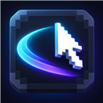
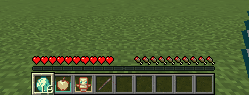
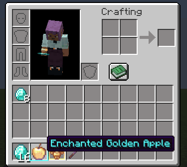
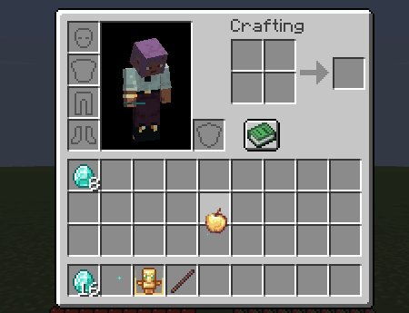
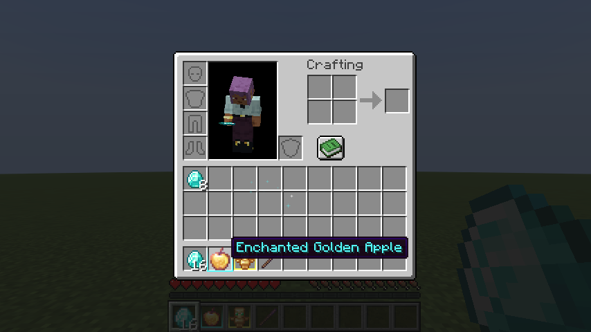
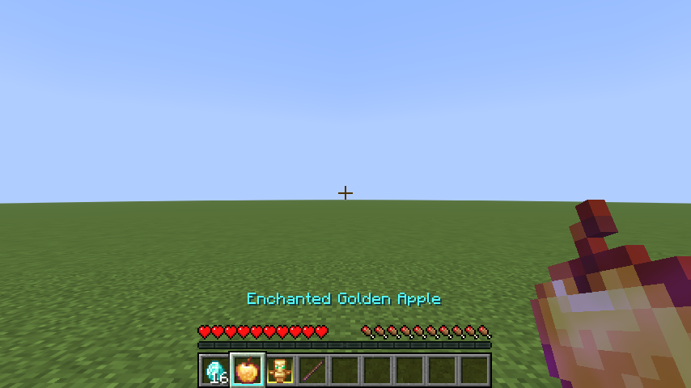
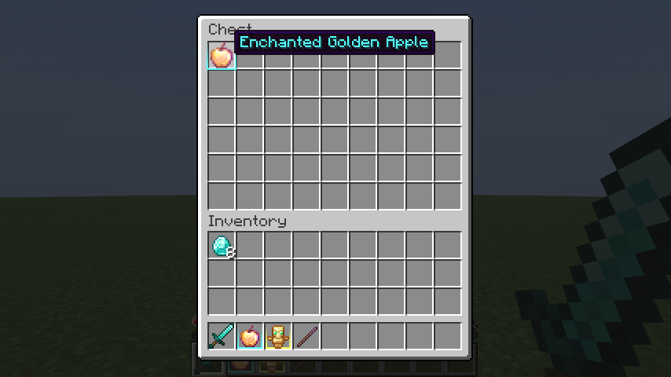

<p align="center">
  
</p>

<h1 align="center">Fluid UI</h1>

[](https://github.com/AloneX15/fluid-ui/actions/workflows/build.yml)
[](https://github.com/AloneX15/fluid-ui/releases)


Animaciones de cliente para el inventario y el HUD: el selector del hotbar se desliza, los ítems se balancean y dejan
una estela del color de su rareza, crecen y brillan bajo el cursor, y los ítems iguales al que llevas flotan.

**Solo de cliente:** instálalo solo en tu juego. Funciona en cualquier servidor (vanilla, Fabric, Paper…) sin que el
servidor lo tenga, y si se pone en un servidor dedicado no se carga ni hace nada.

## Demostración

### Selector del hotbar y zoom del nombre



### Zoom y destello al pasar el cursor



### Balanceo y partículas



### Capturas







Material capturado dentro de Minecraft 26.3 con Held Item Info e ItemBorders. Los GIFs están recortados para destacar
los efectos y optimizados para las fichas de Modrinth y CurseForge.

## Características

- **Selector del hotbar suave:** al cambiar de slot (rueda o números) el marco se desliza en vez de saltar.
- **Zoom en el hotbar:** el ítem seleccionado crece con un pequeño rebote.
- **Nombre del ítem con zoom:** al cambiar de ítem, su nombre aparece con un zoom de entrada y se encoge al
  desvanecerse.
- **Escala al pasar el ratón:** el ítem bajo el cursor crece con un pequeño rebote y vuelve a su tamaño al salir. Se
  dibuja con filtrado suave para que no se deforme al ampliarse.
- **Destello al pasar el ratón** *(nuevo en Fluid UI)*: una franja de luz diagonal cruza el ítem (solo sus píxeles, no
  el slot) nada más poner el cursor encima y se repite cada pocos segundos mientras sigas ahí.
- **Balanceo del ítem en el cursor:** al moverlo rápido por el inventario se inclina con inercia y rebota al pararse.
- **Estela de estrellitas:** los ítems no comunes o encantados en el cursor sueltan estrellitas que titilan, amarillas
  (poco común), aguamarina (raro), magenta (épico) o violeta (encantado); más cuanto más rápido lo mueves.
- **Ítems iguales que flotan:** mientras llevas un ítem, los del contenedor que son iguales se elevan y oscilan.

Todas las animaciones van por tiempo real, no por frames: se ven igual a 30 que a 240 FPS. Cada una se puede desactivar
por separado y, si alguna fallase por un conflicto con otro mod, se desactiva sola sin afectar al juego.

## Instalación

1. Instala [Fabric Loader](https://fabricmc.net/use/) y [Fabric API](https://modrinth.com/mod/fabric-api).
2. Descarga el jar de tu versión de Minecraft desde [Releases](https://github.com/AloneX15/fluid-ui/releases) y ponlo en `mods/`.

Build de desarrollo (último `main`, ya probado): [release `dev`](https://github.com/AloneX15/fluid-ui/releases/tag/dev).

## Compatibilidad

| Minecraft (build probada) | Estado |
|---|---|
| 26.1.2 | ✅ |
| 26.2 | ✅ |
| 26.3 | ✅ |

**Compatible con Held Item Info, ItemBorders, Lithium y FerriteCore** en los perfiles de cliente probados.

- **Held Item Info:** sus líneas, espaciado y fondo se animan como un bloque completo.
- **ItemBorders:** sus bordes siguen al objeto ampliado o elevado en el inventario y el hotbar, tanto por encima como
  por debajo. Instálalo con sus dependencias **Iceberg** y **Prism**.
- **Lithium y FerriteCore:** probados juntos en el perfil de rendimiento.

| Minecraft | Held Item Info | ItemBorders |
|---|---|---|
| 26.1.2 | 1.9.1 | 1.3.1 |
| 26.2 | 1.9.2 | 1.3.2 |
| 26.3 | 1.9.3 | 1.3.3 |

Las integraciones son opcionales y no requieren cambiar la configuración. La matriz de cliente prueba Fluid UI
solo, Held Item Info e ItemBorders por separado y juntos, y Lithium + FerriteCore en un perfil independiente.
Consulta las versiones exactas y las pruebas en [Compatibilidad](docs/compatibilidad.md).

Se prueban inventario, cofres e inventario creativo. Las pantallas de otros mods que hereden el dibujo de slots de
vanilla pueden aprovechar las animaciones; las que reemplazan ese dibujo necesitan validación específica.
Los mixins están documentados en [MIXINS.md](MIXINS.md). Si encuentras un conflicto, abre un
[issue](https://github.com/AloneX15/fluid-ui/issues).

## Configuración

Archivo `config/fluid_ui.json`, que se crea al arrancar el juego. Tras editarlo, escribe `/fluidui reload` en el chat
para aplicar los cambios sin reiniciar. Todas las opciones y sus rangos están en
[docs/configuracion.md](docs/configuracion.md).

## Documentación

- [Guía del mod](docs/guia.md): qué hace cada animación y cómo funciona por dentro.
- [Configuración](docs/configuracion.md): opciones, rangos y comandos.
- [Compatibilidad y pruebas](docs/compatibilidad.md).
- [Mixins](MIXINS.md): qué toca el mod de Minecraft.
- [Publicación](docs/publicacion.md) y [registro de errores](docs/registro-de-errores.md).
- [Changelog](CHANGELOG.md).

Para jugar sin movimiento en la interfaz (accesibilidad), pon `"enabled": false`.

## Desarrollo

```bash
./gradlew :26.3:build              # compila y ejecuta los tests unitarios
./gradlew :26.3:runGameTest        # gametest de servidor (comprueba que no se carga en servidor)
./gradlew :26.3:runClientGameTest  # test de cliente: prueba cada animación y guarda capturas
./gradlew :26.3:runClient          # abre el juego
```

La lógica de las animaciones (curvas, muelle, partículas, destello) y la configuración están en `src/main` y no
dependen de Minecraft, así que se prueban con JUnit. Lo que dibuja está en `src/client`.

## Créditos

Inspirado en las ideas de [Immersive UI](https://modrinth.com/mod/immersive-ui) de Octo Studios. Fluid UI es una
reimplementación independiente escrita desde cero para Minecraft 26.x: no contiene código ni recursos de ese mod.

## Licencia

[MIT](LICENSE).

---

Creado por **TakumiStudios**.
